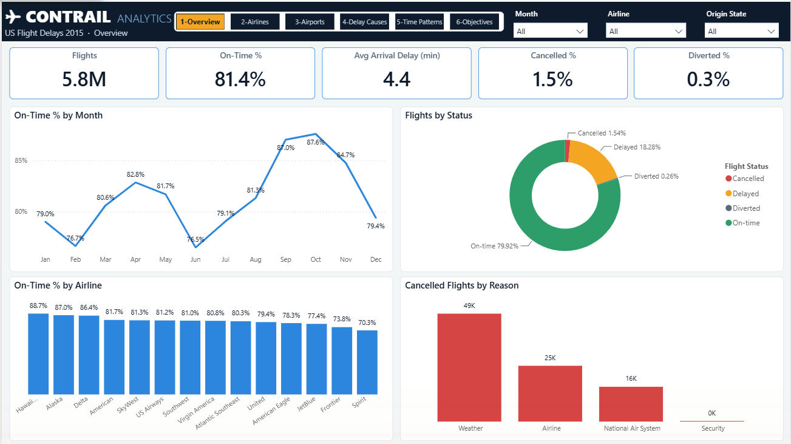
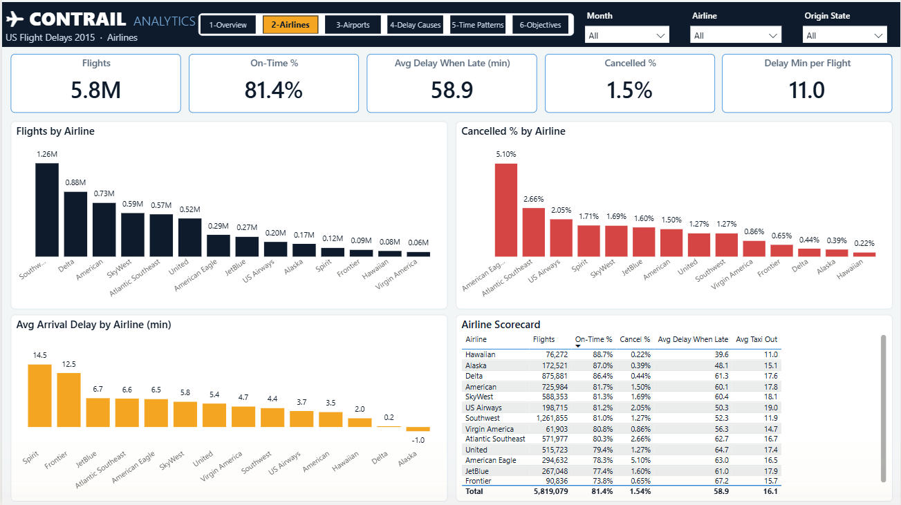
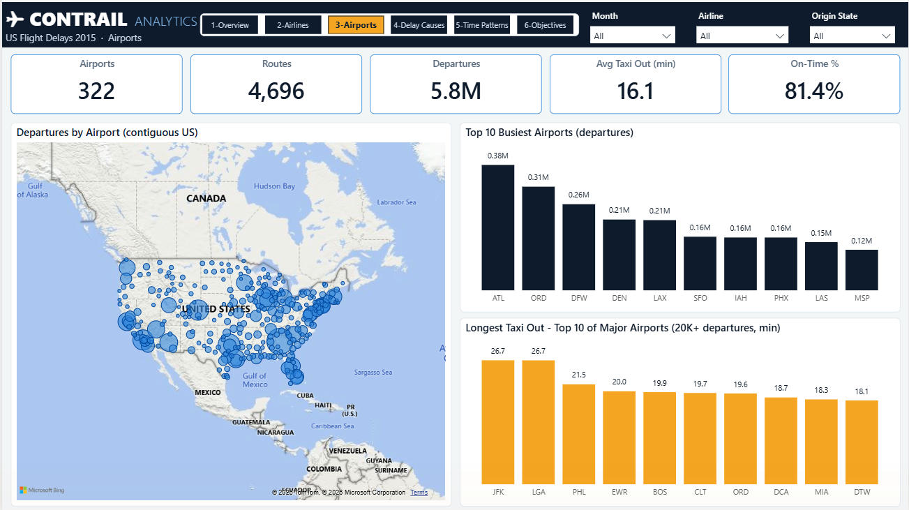
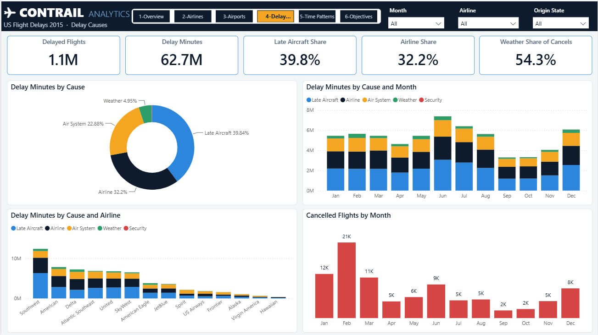
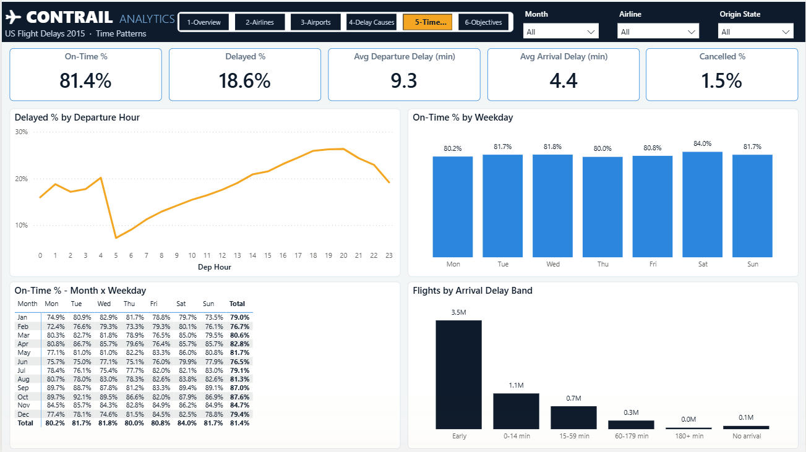
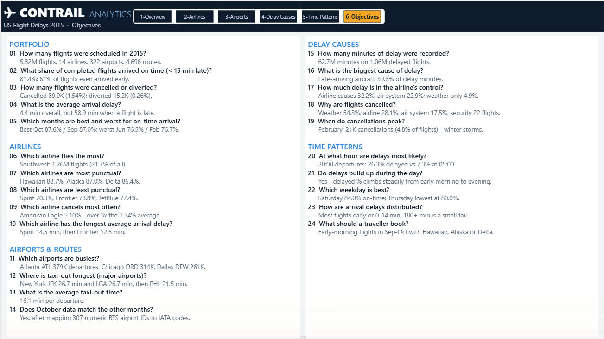

# ✈ US Flight Delays 2015 — Power BI Dashboard

**CONTRAIL Analytics** (fictional airline-analytics brand) · Power BI · Power Query · DAX · Star schema


## Business problem
Airlines and travellers want to know **who is late, where, when and why**. This report analyses every US domestic flight in 2015 (5.8M flights) and answers 24 business questions about punctuality, cancellations, airports and delay causes.

## Data
| Table | Rows | Source |
|---|---|---|
| flights.csv | 5,819,079 | US DOT Bureau of Transportation Statistics, via Kaggle [`usdot/flight-delays`](https://www.kaggle.com/datasets/usdot/flight-delays) |
| airlines.csv | 14 | same |
| airports.csv | 322 | same |

License: **CC0 Public Domain**. `flights.csv` (592 MB) is too big for GitHub — download it from Kaggle. `data/` contains the two small tables and the October airport-ID map.

## Data issues found and fixed
1. **October 2015 uses numeric BTS airport IDs** (e.g. `10397`) instead of IATA codes (`ATL`) for all 486K October flights. I built a mapping table (`data/oct_airport_id_map.csv`, 307 IDs) by matching October flights to September/November flights with the same airline, flight number, distance and scheduled time. All 307 IDs mapped with 99–100% agreement, and the IDs sorted by number give the IATA codes in perfect alphabetical order — a second check that the map is correct.
2. **3 airports without coordinates** (ECP, PBG, UST) → filled from FAA airport reference points so the map shows them.
3. Times stored as `hhmm` numbers (`1435`, `2400`) → converted to real time, hour and time band.
4. Delay-cause columns are only filled for flights ≥ 15 min late; they always add up exactly to the arrival delay (checked).
5. Cancelled / diverted flights have blank delays by design — kept, and handled in the measures.

## Power Query cleaning (10 rules) — see `power-query/`
1. Map October numeric airport IDs → IATA codes (lookup record, fast on 5.8M rows)
2. One `Flight Date` column from year / month / day
3. `hhmm` → `Sched Dep Time`, `Sched Arr Time`, `Dep Hour`, `Dep Time Band`
4. `Flight Status`: On-time / Delayed (≥ 15 min) / Cancelled / Diverted
5. Cancellation codes A/B/C/D → Airline / Weather / National Air System / Security
6. `Delay Band`: Early, 0–14, 15–59, 60–179, 180+ min
7. Delay-cause minutes kept as numbers
8. Unused columns removed (tail number, actual wheels-off/on times…) to keep the model small
9. `Route` (origin–destination) and `Distance Band`
10. Data types set as the last step

## Model
Star schema: **Flights** (fact) → **Date**, **Airlines**, **Airports** (origin, active) and **Airports** (destination, inactive, used with `USERELATIONSHIP`). 29 DAX measures in `dax/measures.dax`.

## Report pages
| Page | Content |
|---|---|
| 1 · Overview | KPIs, on-time % by month, status mix, on-time % by airline, cancellation reasons |
| 2 · Airlines | volume, cancel %, average delay, airline scorecard |
| 3 · Airports | map of departures, top 10 busiest airports, longest taxi-out |
| 4 · Delay Causes | delay minutes by cause, by month and by airline; cancellations by month |
| 5 · Time Patterns | delayed % by hour, on-time % by weekday, month × weekday heat table, delay bands |
| 6 · Objectives | the 24 business questions with answers |

Slicers on every page: Month, Airline, Origin State.

## Key insights
- **81.4%** of completed flights arrived on time; **61%** even arrived early — but a late flight is late by **58.9 min** on average.
- **Hawaiian (88.7%), Alaska (87.0%) and Delta (86.4%)** are the most punctual; **Spirit (70.3%)** and **Frontier (73.8%)** the least.
- **American Eagle cancels 5.1%** of flights — over 3× the 1.54% average.
- **Late-arriving aircraft cause 39.8%** of all delay minutes; airline causes 32.2%; weather only 4.9% of delay minutes but **54.3% of cancellations**.
- Delays **build up during the day**: 7.3% of 05:00 departures are late vs 26.3% at 20:00.
- **February** has the most cancellations (21K, winter storms); **September–October** are the most punctual months (87%+).
- **New York JFK and LGA** have the longest taxi-out among major airports (26.7 min).

## Screenshots







## Repository
```
dashboard/     Power BI Project (PBIP: TMDL model + report definition)
data/          airlines.csv, airports.csv, oct_airport_id_map.csv
power-query/   M code for every table
dax/           all DAX measures
images/        screenshots + GIF
```
To open: download `flights.csv` from Kaggle into a folder, update the `RawFolder` / `CleanFolder` parameters in Power Query, open `dashboard/FlightDelays.pbip` in Power BI Desktop and refresh.

---
**Ahmed Saad** — Data Analyst · [GitHub](https://github.com/AhmedSaad-DataAnalyst)
